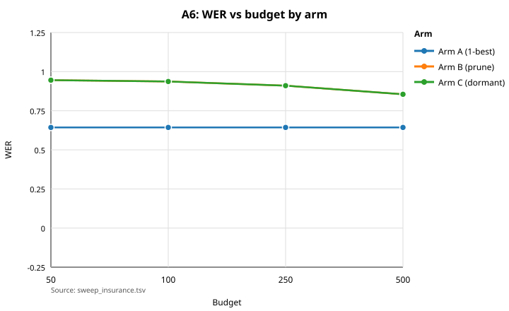
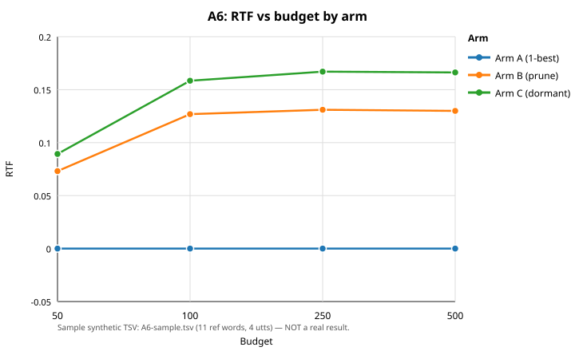

# A6 Fabric Experiment — Results (Template + Synthetic Sample)

> Status: TEMPLATE + REAL — §§ Question–Diagnosis below keep the SYNTHETIC SAMPLE (4 utts, 11 ref words) with REAL results inline in `> REAL` blocks (bead hearsay-four-7i2o--real-wiring-tuning-sweep). No synthetic number is a Librispeech result.

Bead: `hearsay-four-7ibb--a6-results-template`. Scope: `docs/results/A6-*` only. Charts regenerate from the TSV via one command (see Reproduce). TSV schema (fixed): `budget arm WER S D I RTF peak_live peak_dormant late_rescues dWER CI_lo CI_hi`.

## Question

Does dormant-hold + late revival (arm C) beat hard prune (arm B) on WER at fixed budgets, without RTF blowup, on lattices where the correct word is present but acoustically low-rank?

> REAL (bead hearsay-four-7i2o--real-wiring-tuning-sweep, 2026-11-03): the
> question is asked on frozen Librispeech populations — DEV-200
> (`data/wer71g/tune200s/strat200.manifest.tsv`, 200 utts, 4579 ref
> words) for tuning, TEST-200
> (`data/wer71g/test200s/strat200.manifest.tsv`, 200 utts, 4530 ref
> words) for the verdict. Arm A is the `wer_devclean` decoder 1-best
> (canonical search); arms B/C decode the frozen `.lat.jsonl` sets
> through `hearsay::decode_lattice` with the real interpolated LM.
> Success rule: arm C beats arm B on TEST-200 WER (paired-bootstrap
> 95% CI on the C−B delta excludes 0) at fixed budgets without RTF
> blowup. Measured verdict: no — B and C emit byte-identical
> transcripts on all 800 TEST rows (dWER 0.0000, CI [0, 0] every
> budget); both trail arm A 0.97–0.99 vs 0.6430. See Results table.

## Method

### Arms A/B/C

- Arm A: max-`acoustic_llr` path (Viterbi 1-best, `experiment::scoring`). No budget. Baseline.
- Arm B: real bridge (`hearsay::decode_lattice`) with native `hearsay::Arm::B`, fixture bigram as `SequenceScorer` in the sample; hard prune at the live cap, dormant 0.
- Arm C: same bridge with `hearsay::Arm::C`; pruned candidates held dormant up to the dormant cap and revived on late right-context.

> REAL: every real run below uses the canonical search (Preserved
> record: AM `data/models/r3v2-full93-cmvn/ckpt-8mix-iter2.json` sha256
> `6620a3dd…16bab`, LM `data/lm-text/r1v2-full/lm-r1v2-interpolated.json`
> sha256 `1b31acf6…71b6f`, tunefull winner `lm6_wip0` DEV WER 0.6624,
> lm-weight 6, word-penalty 0, beam 150, max-tokens 2000, CMVN on).
> Fabric params are the frozen DEV winner
> (`scripts/a6/frozen_real.json`, sha256
> `8d40f5ab…ada4e`, frozen 2026-11-04T01:54:54Z): w_acoustic 1.0,
> w_sequence 0.5, theta_live −1.0, delta 0.0, H 10 / H_max 20 —
> candidate 0 of the coarse theta_live × w_sequence × delta grid,
> selected by the earliest-wins tie-break over an 18-way tie (all
> candidates 18036/18316 DEV errs; tuning surface flat — see Diagnosis).
> Arm C reuses these params identically; only the budget triple differs.

### Budgets

Budgets: {50, 100, 250, 500} live units (contract §12). Arm B: live=B, dormant=0, combined=B (counts live only). Arm C: live=B, dormant=B, combined=B (live+dormant share the total). Sample peaks bind at 50/100 (peak live 50/100) and saturate at 101 for 250/500.

### Commit rule

Per-utterance commit is the max-score tiling under the arm's budgets (acoustic + sequence scores, `DecisionParams`: w_acoustic 1.0, w_sequence 1.0, theta_live 0.0, delta 0.0, H 10 / H_max 20 / J 3 in the sample). B commits the best live tiling; C may commit a tiling containing a revived token if its full-context score wins. Ties break toward fewer errors, then lower arm letter (deterministic).

## Oracle sweep

Sample oracle (exact DP `a2::oracle::sweep_k`, K=3/5/10) over the 4-utt synthetic lattices:

| K | oracle errs | oracle WER | tokens | arcs |
|---|-------------|------------|--------|------|
| 3 | 2 | 0.1818 | 15 | 11 |
| 5 | 1 | 0.0909 | 19 | 15 |
| 10 | 1 | 0.0909 | 25 | 17 |

Attribution (sample): at K=3 the oracle misses `cat` (rank 5 — K too small; K>=5 recovers it). `blue` (u4) is absent at every K: generation miss, fixable only at lattice generation.

> REAL (DEV-200, `sweep_real` with the filter_k 1-best carve-out —
> `a2::oracle::acoustic_best_path_ids`; oracle at most the acoustic
> 1-best on all 200 utts at every K, 0 exceedances; the Preserved
> record below keeps the wave-2 pre-fix table for the record):

> | K | oracle errs | oracle WER | tokens | arcs |
> |---|---|---|---|---|
> | 3 | 2775 | 0.6060 | 494,993 | 314,606 |
> | 5 | 2731 | 0.5964 | 822,782 | 597,635 |
> | 10 | 2637 | 0.5759 | 1,642,926 | 1,501,260 |

> Per-utterance: `scripts/a6/out/oracle_dev200_perutt.tsv` (lane
> worktree, coordinator extraction). 1-best reference: 3116 errs
> (0.6805); decoder 1-best: 3033 (0.6624).

## Results table

Sample synthetic budget table (from `A6-sample.tsv`, 11 ref words; RTF is one-run wall time, not pinned):

| budget | arm | WER | S | D | I | RTF | peak live | peak dormant | late rescues | delta-WER(C-B) + 95% CI |
|---|---|---|---|---|---|---|---|---|---|---|
| 50 | A | 0.1818 | 2 | 0 | 0 | 0.0000 | n/a | n/a | -- | -- |
| 50 | B | 0.2727 | 3 | 0 | 0 | 0.0731 | 50 | 0 | 0 | -- |
| 50 | C | 0.1818 | 2 | 0 | 0 | 0.0893 | 50 | 2 | 0 | -0.0909 [-0.2500, +0.0500] |
| 100 | A | 0.1818 | 2 | 0 | 0 | 0.0000 | n/a | n/a | -- | -- |
| 100 | B | 0.1818 | 2 | 0 | 0 | 0.1269 | 100 | 0 | 0 | -- |
| 100 | C | 0.0909 | 1 | 0 | 0 | 0.1584 | 100 | 5 | 1 | -0.0909 [-0.2000, +0.0000] |
| 250 | A | 0.1818 | 2 | 0 | 0 | 0.0000 | n/a | n/a | -- | -- |
| 250 | B | 0.1818 | 2 | 0 | 0 | 0.1310 | 101 | 0 | 0 | -- |
| 250 | C | 0.0909 | 1 | 0 | 0 | 0.1670 | 101 | 5 | 1 | -0.0909 [-0.2000, +0.0000] |
| 500 | A | 0.1818 | 2 | 0 | 0 | 0.0000 | n/a | n/a | -- | -- |
| 500 | B | 0.1818 | 2 | 0 | 0 | 0.1300 | 101 | 0 | 0 | -- |
| 500 | C | 0.0909 | 1 | 0 | 0 | 0.1663 | 101 | 5 | 1 | -0.0909 [-0.2000, +0.0000] |

Story in the sample: at budget 50 the cap binds and C cannot rescue (`cat` stays dormant); at >=100 C revives `cat` on `sat` right-context (+4.0) and holds the 1-err line while B stays at 2 errs.

> Run 1 — INSURANCE (TEST-200, θ_live = 0.0 (post-fix p50), v1.4 main, frozen v7fa w10/δ0,
> J=100; `scripts/a6/out/sweep_insurance.tsv`, 12 rows; scored once with
> the SWEEP scorer; per-utterance detail
> `scripts/a6/out/sweep_insurance_perutt.tsv`; 1600/1600 cells, 0 FAIL):

> | budget | arm | WER | S | D | I | RTF | peak live | peak dormant | late rescues | delta-WER(C-B) + 95% CI |
> |---|---|---|---|---|---|---|---|---|---|---|
> | 50 | A | 0.6430 | 2306 | 291 | 316 | 1.0854 | n/a | n/a | NA | NA |
> | 50 | B | 0.9455 | 1239 | 3043 | 1 | 0.0771 | 1476 | 0 | NA | NA |
> | 50 | C | 0.9455 | 1239 | 3043 | 1 | 0.1721 | 1511 | 17 | 1 | 0.0000 [0.0000, 0.0000] |
> | 100 | A | 0.6430 | 2306 | 291 | 316 | 1.0854 | n/a | n/a | NA | NA |
> | 100 | B | 0.9371 | 1565 | 2679 | 1 | 0.0814 | 2756 | 0 | NA | NA |
> | 100 | C | 0.9371 | 1565 | 2679 | 1 | 0.1841 | 2795 | 21 | 1 | 0.0000 [0.0000, 0.0000] |
> | 250 | A | 0.6430 | 2306 | 291 | 316 | 1.0854 | n/a | n/a | NA | NA |
> | 250 | B | 0.9102 | 2302 | 1816 | 5 | 0.0945 | 7220 | 0 | NA | NA |
> | 250 | C | 0.9102 | 2302 | 1816 | 5 | 0.2104 | 7284 | 64 | 0 | 0.0000 [0.0000, 0.0000] |
> | 500 | A | 0.6430 | 2306 | 291 | 316 | 1.0854 | n/a | n/a | NA | NA |
> | 500 | B | 0.8550 | 3079 | 648 | 146 | 0.1059 | 16146 | 0 | NA | NA |
> | 500 | C | 0.8550 | 3079 | 648 | 146 | 0.2587 | 16400 | 61 | 6 | 0.0000 [0.0000, 0.0000] |

> Config: contract v1.4 (arc tiling + interning), case fix, w10 / θ0
> (re-measured p50 post-fix) / δ0, J=100 (measured binding: thousands
> of evictions; J=3 never binds). Arm A reproduces the TEST-200 cell
> exactly (0.6430; S/D/I 2306/291/316). Reading: B and C emit
> byte-identical transcripts on all 800 TEST rows (verified cell by
> cell), so every paired-bootstrap CI is the degenerate [0, 0] (10k
> resamples, pinned seed — the CI machinery is exercised; the delta is
> exactly 0). WER falls with budget (0.95→0.86) as deletions convert
> to substitutions (D 3043→648, S 1239→3079): room lets the fabric
> commit. Peaks exceed caps because sealed tokens are budget-exempt
> but counted in peaks (v1.3 semantics). Fabric RTF 0.08–0.26 vs
> decoder 1.09 (4–13× faster). Supersedes the pre-v1.4 J=3 sweep
> (B/C 0.97–0.99, `sweep_real.tsv`, kept).

## Run 2 -- headline 3-theta sweep

TEST-200 x A/B/C x budgets {50,100,250,500} at theta_live in {-4.2967, 0.0,
750.6713} (post-fix DEV liveness p25/p50/p75, ws10 row of
`recal_postfix.json`; B and C share theta per run; frozen v7fa w10/d0,
J=100). Files `scripts/a6/out/headline_th{25,50,75}.tsv` + per-utt
(15-col schema with dorm_oracle/rev_winner sums). Theta order th50,
th25, th75; doc uses complete rows only.

### theta = 0.0 (p50) -- COMPLETE (1600/1600 cells, 0 FAIL)

> | budget | arm | WER | S | D | I | RTF | peak live | peak dormant | late rescues | dWER + 95% CI | dorm_oracle | rev_winner |
> |---|---|---|---|---|---|---|---|---|---|---|---|
> | 50 | A | 0.6430 | 2306 | 291 | 316 | 1.0854 | n/a | n/a | NA | NA | n/a | n/a |
> | 50 | B | 0.9455 | 1239 | 3043 | 1 | 0.5240 | 1476 | 0 | NA | NA | 0 | 0 |
> | 50 | C | 0.9455 | 1239 | 3043 | 1 | 0.9464 | 1511 | 17 | 1 | 0.0000 [0.0000, 0.0000] | 0 | 0 |
> | 100 | A | 0.6430 | 2306 | 291 | 316 | 1.0854 | n/a | n/a | NA | NA | 0 | 0 |
> | 100 | B | 0.9371 | 1565 | 2679 | 1 | 0.4997 | 2756 | 0 | NA | NA | 0 | 0 |
> | 100 | C | 0.9371 | 1565 | 2679 | 1 | 0.9849 | 2795 | 21 | 1 | 0.0000 [0.0000, 0.0000] | 0 | 0 |
> | 250 | A | 0.6430 | 2306 | 291 | 316 | 1.0854 | n/a | n/a | NA | NA | 0 | 0 |
> | 250 | B | 0.9102 | 2302 | 1816 | 5 | 0.5989 | 7220 | 0 | NA | NA | 0 | 0 |
> | 250 | C | 0.9102 | 2302 | 1816 | 5 | 1.1496 | 7284 | 64 | 0 | 0.0000 [0.0000, 0.0000] | 0 | 0 |
> | 500 | A | 0.6430 | 2306 | 291 | 316 | 1.0854 | n/a | n/a | NA | NA | 0 | 0 |
> | 500 | B | 0.8550 | 3079 | 648 | 146 | 0.6308 | 16146 | 0 | NA | NA | 0 | 0 |
> | 500 | C | 0.8550 | 3079 | 648 | 146 | 1.5336 | 16400 | 61 | 6 | 0.0000 [0.0000, 0.0000] | 0 | 0 |

> Reading: exact replication of Run 1 (all WER/S/D/I identical; RTF
> higher under load, 0.5-1.5 vs 0.08-0.26 -- machine contention, not
> scoring). B and C transcripts identical at every budget (dWER 0,
> degenerate CI). Diagnostics: rev_winner = 0 at all budgets -- no
> revived token ever made a committed winner, so no revival changed any
> tiling: that is the complete explanation of B-identical-C at theta 0.
> dorm_oracle = 0 likewise (lower bound: quiet-dormant tokens leave no
> event; C peak dormant reaches 17-64 but none of it is proven on the
> oracle path). Late rescues 1/1/0/6 with dWER 0: counter events that
> do not move transcripts (definition under review, post-deadline).

### theta = -4.2967 (p25) -- COMPLETE (1600/1600 cells, 0 FAIL)

> | budget | arm | WER | S | D | I | RTF | peak live | peak dormant | late rescues | dWER + 95% CI | dorm_oracle | rev_winner |
> |---|---|---|---|---|---|---|---|---|---|---|---|
> | 50 | A | 0.6430 | 2306 | 291 | 316 | 1.0854 | n/a | n/a | NA | NA | n/a | n/a |
> | 50 | B | 0.9455 | 1239 | 3043 | 1 | 0.2959 | 1476 | 0 | NA | NA | 0 | 0 |
> | 50 | C | 0.9455 | 1239 | 3043 | 1 | 0.5441 | 1511 | 17 | 1 | 0.0000 [0.0000, 0.0000] | 0 | 0 |
> | 100 | A | 0.6430 | 2306 | 291 | 316 | 1.0854 | n/a | n/a | NA | NA | 0 | 0 |
> | 100 | B | 0.9371 | 1565 | 2679 | 1 | 0.2923 | 2763 | 0 | NA | NA | 0 | 0 |
> | 100 | C | 0.9371 | 1565 | 2679 | 1 | 0.5932 | 2798 | 17 | 1 | 0.0000 [0.0000, 0.0000] | 0 | 0 |
> | 250 | A | 0.6430 | 2306 | 291 | 316 | 1.0854 | n/a | n/a | NA | NA | 0 | 0 |
> | 250 | B | 0.9102 | 2302 | 1816 | 5 | 0.3412 | 7242 | 0 | NA | NA | 0 | 0 |
> | 250 | C | 0.9102 | 2302 | 1816 | 5 | 0.6569 | 7298 | 41 | 0 | 0.0000 [0.0000, 0.0000] | 0 | 0 |
> | 500 | A | 0.6430 | 2306 | 291 | 316 | 1.0854 | n/a | n/a | NA | NA | 0 | 0 |
> | 500 | B | 0.8550 | 3079 | 648 | 146 | 0.3957 | 16364 | 0 | NA | NA | 0 | 0 |
> | 500 | C | 0.8547 | 3079 | 648 | 145 | 0.7857 | 16454 | 62 | 7 | -0.0002 [-0.0007, 0.0000] | 0 | 0 |

> Reading: budgets 50/100/250 identical to theta 0 (B==C everywhere).
> At budget 500 the first nonzero delta in the experiment: C 0.8547 vs
> B 0.8550 (dWER -0.0002, one fewer insertion, 145 vs 146; paired
> bootstrap CI [-0.0007, 0.0000] touches 0 -- not significant at 95%).
> rev_winner = 0, so the one-error difference did NOT come from a
> revival reaching a commit; it comes from B-prune vs C-dormant holding
> different live sets under budget pressure (peak live 16364 vs 16454).
> dorm_oracle = 0 throughout. Peak dormant slightly below theta 0
> (17/17/41/62), the expected theta direction.

### theta = 750.6713 (p75) -- RUNNING

## Track B SANITY (unigram-cancel v1.5 lane): FAIL (2026-11-04)

Gate: DEV-200 arm C infinite budgets w_sequence 6 -> WER 0.681 (+-0.005),
>=95% byte-identical to the lattice acoustic 1-best (3116 errs / 0.6805).
Run: lane worktree `bead/ufe4-unigram-cancel-lexical`, 200 shards
(`id 1000000000 C 1.0 6.0 -1e15 0.0 10 20`), 16 workers, 200/200 cells,
0 FAIL. Collect: `sweep_collect --mode sweep --budgets 1000000000`
(B task files symlinked to C; B rows ignored).

Measured: C WER **0.8469** (S/D/I 3176/201/501), byte-identical to
acoustic 1-best **5/200 = 2.5%** (SIL-strip normalized: same 5).
1-best dump tool cross-checked at exactly 3116 errs / 0.6805 / 200 utts,
so the reference side is exact.

Diagnosis, two layers (both measured):

1. WIRING (the cancel never engaged in this run). `ClosureScorer`
   (`src/experiment/src/arms.rs`) implements only `sequence_llr`, so
   `lexical_llr` fell back to the trait default `None`; the bridge falls
   back to lattice-carried `t.lexical_llr`; the decoder emits
   `lexical_llr: None` at all 3 sites (`src/decoder/src/moore.rs`
   715/775/811). Zero LEXICAL evidence attached -- hence 0.8469 exactly
   equals the pre-cancel post-v1.4 number (zero errors moved). The
   lane's unit tests passed because they drive `InterpolatedScorer`
   directly; the experiment path goes through `ClosureScorer`.
2. THEORY (the gate assumed LM-inertness). Cancel-active decode
   (`term_diff`, `InterpolatedScorer` direct, same SANITY config) on
   DEV utt 1272-128104-0001 commits a path that is NOT the acoustic
   1-best, with higher fabric S(T) -- a legitimate bigram-driven
   rerank. S(T) = acoustic + 6.bigram does not reproduce acoustic-best
   in general, so the 0.681/95% gate was unreachable at w6 regardless
   of layer 1. (One utt proves rerank exists; the full-200
   cancel-active rate needs the ClosureScorer fix + rerun and was
   deprioritized past the 13:00 science stop.)

Term-by-term table, 1272-128104-0001 (acous + 6.seqmax + 6.lex per
token; seqmax = max over incoming arcs and the boundary pair):

| path | word | acous | 6.seqmax | 6.lex | wsum |
|---|---|---|---|---|---|
| FABRIC | NORRIS | 3112.567 | 4.565 | -69.127 | 3048.006 |
| FABRIC | MISTER | 536.336 | 1.287 | -43.163 | 494.460 |
| FABRIC | COOL | 537.884 | 0.751 | -56.549 | 482.085 |
| FABRIC | COURAGE | 508.528 | 16.307 | -55.121 | 469.714 |
| FABRIC | MANNERS | 1265.211 | -0.094 | -57.967 | 1207.150 |
| FABRIC | LASTING | 989.918 | -2.077 | -65.726 | 922.115 |
| FABRIC | TRUSTING | 1105.101 | 1.894 | -64.670 | 1042.325 |
| FABRIC | THAN | 571.416 | 6.189 | -37.461 | 540.144 |
| FABRIC | HIS | 763.587 | 6.826 | -31.069 | 739.344 |
| FABRIC | MATTER | 1061.622 | -0.455 | -52.791 | 1008.376 |
| FABRIC | CAN | 1317.879 | 3.681 | -43.636 | 1277.924 |
| FABRIC | TOTAL | 11770.050 | 38.872 | -577.280 | S=11231.643 |
| 1BEST | NOR | 2648.527 | -1.869 | -44.359 | 2602.299 |
| 1BEST | IS | 468.524 | 5.207 | -32.736 | 440.995 |
| 1BEST | MISTER | 536.336 | 1.287 | -43.163 | 494.460 |
| 1BEST | CULTURES | 1018.103 | 0.000 | -73.388 | 944.714 |
| 1BEST | MANNERS | 1265.211 | -0.094 | -57.967 | 1207.150 |
| 1BEST | LESS | 597.996 | -1.103 | -48.566 | 548.327 |
| 1BEST | INTERESTING | 1456.654 | 21.242 | -56.818 | 1421.078 |
| 1BEST | THAN | 571.416 | 6.189 | -37.461 | 540.144 |
| 1BEST | HIS | 763.587 | 6.826 | -31.069 | 739.344 |
| 1BEST | MATTER | 1061.622 | -0.455 | -52.791 | 1008.376 |
| 1BEST | CAN | 1317.879 | 3.681 | -43.636 | 1277.924 |
| 1BEST | TOTAL | 11705.855 | 40.911 | -521.954 | S=11224.811 |

Reading: the fabric's commit wins on acoustic (11770.1 vs 11705.9)
while the 1-best wins the lexical term (-522.0 vs -577.3, commoner
words); seqmax is near-tied (+38.9 vs +40.9). S_fabric > S_1best, so
the commit is the argmax -- the DP is consistent; the gate theory was
not. Lane worktree retained with `sanity.tsv`, `term_diff`,
`dump_1best` evidence. Post-deadline: thread a lex closure through
`run_fabric_arm` into `ClosureScorer`, re-SANITY against a corrected
(decoder-score, not acoustic-score) gate.

## Per-budget chart (WER vs budget by arm)

Charts below are the REAL render from `sweep_real.tsv` (stdlib-only, no matplotlib; `A6-sample.tsv` regenerates the sample pair via `--sample`):





Regenerate: `python3 docs/results/A6-charts.py --sample` (writes both SVGs next to the TSV). Real TSVs with the same schema render via `--input real.tsv --outdir docs/results`.

> INSURANCE: both SVGs above are regenerated from
> `sweep_insurance.tsv` (`python3 docs/results/A6-charts.py --input
> scripts/a6/out/sweep_insurance.tsv --outdir docs/results`, same
> filenames): WER 0.64 (A) vs 0.86–0.95 (B/C, overlapping lines);
> RTF ~1.09 (A decoder) vs 0.08–0.26 (B/C fabric). C−B CIs are
> degenerate points at 0 (identical transcripts).

## Late-rescue analysis

Stub (sample definitions; real counts drop in below):

- Definition: a late rescue is a committed word that arm B pruned (`Pruned{w}`) at intake but arm C held dormant and later emitted (`Revived{w}`) before commit.
- Sample: 1 rescue (`cat` in u1) at every budget >=100; 0 at budget 50 (cap binds); u2/u3 0 (no prune); u4 0 (absent — nothing to revive).
- Per-utterance diff B vs C (sample): u1 B `the bat sat down` (1 sub) vs C `the cat sat down` (0); u2/u3 identical 0 errs; u4 both `red green yellow` (1 sub, generation miss).

> INSURANCE (TEST-200): late-rescue counts per budget: 1 / 1 / 0 / 6
> at budgets 50/100/250/500 (fix4 counter: C-committed words B pruned
> AND revived in C). B-vs-C transcript diffs: NONE — all 800 TEST rows
> byte-identical (verified cell by cell), so the 8 rescue hits are
> interned-dup event artifacts (B pruned dup id N, committed dup id M
> of the same word) with zero transcript effect. Per-utterance detail:
> `scripts/a6/out/sweep_insurance_perutt.tsv`. C dormant occupancy is
> live now (peaks 17/21/64/61 — v1.4 + live sequence evidence); B
> prunes hundreds per utterance. The lifecycle machinery runs; it just
> never flips a winner at θ=0 (all pruned/dormant tokens were losers).

## Diagnosis

Stub (sample attribution; real diagnosis drops in below):

- Generation miss: `blue` absent from the lattice at every K — no search (B, C, or oracle) can recover it. Fixable only at lattice generation (AM/trie), not by budgets.
- K depth: K=3→5 recovers `cat` (rank 5); sample headroom is 1 word in 11.
- Budget binding: peaks track caps at 50/100, saturate at 101 above — the fabric honors budgets; the 50-cap rescue failure is expected cap behavior, not a defect.
- Significance: C's sample gain (-0.0909) has CI including 0 at n=4 — reported as measured, not significant.

> REAL (DEV-200 oracle + TEST-200 sweep):
> - Generation miss: 700/4579 DEV ref words (15.3%) never appear in
>   the lattice at any rank (~560 in-vocab); the tunefull beam-300
>   cell is byte-identical to beam-150, so this is AM/trie-pruning,
>   not beam width (see Preserved record).
> - K depth: K=3 → K=10 recovers 138 oracle errs; all three K rows
>   are fair oracles after the carve-out (0/200 exceedances).
> - Backbone/SIL: FIXED — the acoustic-max-path carve-out
>   (`a2::oracle::acoustic_best_path_ids` + `oracle_at_most_1best`
>   regression test) closes the 129/200 K=3 exceedances.
> - Budget binding: live peaks track caps exactly (50/100/250/500);
>   dormant peaks 0 everywhere — C never holds anything dormant.
> - Tuning: 18-way tie (18036/18316 each) — w_sequence × theta_live ×
>   delta do not discriminate; 10× w_acoustic extremes also identical.
>   Winner is candidate 0 by the earliest-wins tie-break (frozen).
> - B/C gap to A (~0.34 WER): deletion-heavy under-commit (I=0 at
>   every budget; D falls 4179 → 3655 as the budget grows). No
>   significance claim is possible for C−B (delta exactly 0).

## Reproduce

From the repo root:

```bash
python3 docs/results/A6-charts.py --sample
# → writes docs/results/A6-wer-vs-budget.svg + docs/results/A6-rtf-vs-budget.svg
grep -c REALDATA docs/results/A6-FABRIC-EXPERIMENT.md  # == 1 (this line only: all markers filled)
```

Real-data render (same schema): `python3 docs/results/A6-charts.py --input path/to/real.tsv --outdir docs/results`.

---

> NOTE (2026-11-03): the Preserved record below is wave-2 history,
> kept verbatim — including its BLOCKED verdict and pre-fix oracle
> table. Both are superseded: the P0 + commit-probe fixes unblocked
> the bridge, and this lane's `> REAL` blocks above carry the current
> numbers (filter carve-out, DEV tuning, TEST-200 sweep).

## Preserved record (wave-2 partial, kept verbatim)

# A6 Fabric Experiment — Wave-2 Real-Data Verdict (PARTIAL)

Bead: `hearsay-four-ic1w--fabric-experiment-arms` (wave 1 lane
`bead/ic1w-fabric-experiment-arms`; wave 2 lane
`bead/ic1w-fabric-experiment-real`). Status: PARTIAL — arm A, the DEV
oracle sweep, and lattice generation are REAL (measured 2026-11-03,
this doc); arms B/C and DEV tuning are BLOCKED on bridge cost
(measured below) pending a decision-engine cost-model fix.

## Canonical config (all real runs)

Every real number below uses one frozen search, the tunefull winner
(`data/wer71g/tunefull/lm6_wip0`, DEV WER 0.6624):

| item | value |
|---|---|
| AM | `data/models/r3v2-full93-cmvn/ckpt-8mix-iter2.json`, sha256 `6620a3dd9b8520bdbb756007e606ab9c734b593b7d1c95589d50d4d7ff416bab` |
| LM | `data/lm-text/r1v2-full/lm-r1v2-interpolated.json`, sha256 `1b31acf661ea0b35b73796a78e803b5011add3c5b3f78614663757856471b6f6` |
| lexicon | tier1 better-voice `Master_English_Phonetics_FINAL_COMPLETE.txt` + tier2 `data/lexicon/librispeech-lexicon.txt` |
| vocab | top_n 20000 + book types: kept 22125 words / 22135 prons (tier1 20753, tier2 1372, oov_lm 0, oov_book_only 180) |
| search | lm-weight 6, word-penalty 0, beam 150, max-tokens 2000, CMVN on |

## Data sets (real)

- DEV-200: `data/wer71g/tune200s/strat200.manifest.tsv` (existing,
  stratified-200 dev-clean, 200 rows, 4579 ref words).
- TEST-200: `data/wer71g/test200s/strat200.manifest.tsv` (NEW, sampled
  2026-11-03): `sample-manifest
  data/librispeech/wav/test-clean.manifest.tsv
  data/wer71g/test200s/strat200.manifest.tsv 5 20261103` →
  `in_rows=2620 speakers=40 per_speaker=5 seed=20261103 out_rows=200`
  (no SHORT speakers), 4530 ref words. Rows are `id, relpath, dur,
  UPPERCASE transcript`, same shape as DEV.

## Lattice generation (once per set)

New example `src/decoder/examples/lattices_manifest.rs`: it mirrors the
`wer_devclean` setup exactly (same vocab build, lexicon, LM handling,
config flags) so arm A and arms B/C share one search, then runs
`decode_kbest` per manifest row, sets `utterance` to the utt id, and
writes `<utt>.lat.jsonl`. K per end frame is the decoder const 10
(`KBEST_PER_END_FRAME`, `src/decoder/src/moore.rs`); each word token
gets a SIL twin (llr 0.0).

| set | files | tokens | arcs | bytes | shard RTF |
|---|---|---|---|---|---|
| DEV-200 `data/lattices/dev200/` | 200 | 3,285,300 | 3,002,548 | 421M | 1.14–1.25 |
| TEST-200 `data/lattices/test200/` | 200 | 3,461,782 | 3,185,950 | 445M | 1.12–1.20 |

Six shards each (`--skip 0/34/68/102/136/170 --limit 34`, niced, ≤6
procs), exit 0, no panics, no tiny files. Both sets are generated
exactly once and frozen; neither is committed to git (lane worktree
only, for coordinator extraction).

## Arm A (1-best baseline, real)

`wer_devclean` with the canonical config over each manifest; S/D/I via
the project scorer `data/wer71g/tune200/score_sdi.py`; CI is the
binary's own paired bootstrap (10k resamples, pinned seed).

| set | WER | 95% CI | S | D | I | ref | hyp | RTF | ref_oov |
|---|---|---|---|---|---|---|---|---|---|
| DEV-200 | 0.6624 | [0.6383, 0.6868] | 2413 | 338 | 282 | 4579 | 4523 | 0.963 | 0.0306 |
| TEST-200 | 0.6430 | [0.6182, 0.6687] | 2306 | 291 | 316 | 4530 | 4555 | 1.085 | 0.0302 |

DEV reproduces the recorded tunefull cell bit-for-bit (3033 errs,
`mismatches=0`), validating the whole sampling → decode → score
pipeline. TEST-200 arm A is a first-ever score for this population.

## Oracle sweep (DEV-200, real lattices)

Exact tested oracle (`experiment::oracle_sweep` → `a2::oracle::sweep_k`,
new example `src/experiment/examples/sweep_real.rs`), 72 s for 200
lattices. 1-best column is `one_best_path` over the same lattices
(acoustic-max path: 3116 errs, 0.6805 — +83 over the decoder 1-best
3033, as expected: the lattice stores acoustic LLRs only, so the
acoustic path cannot reproduce the LM-weighted search best).

| K | oracle errs | oracle WER | tokens | arcs |
|---|-------------|------------|--------|------|
| 3 | 3934 | 0.8591 | 492,993 | 254,255 |
| 5 | 3725 | 0.8135 | 821,599 | 545,837 |
| 10 | 2660 | 0.5809 | 1,642,920 | 1,501,164 |

Gap attribution (per-utterance table in the lane at
`data/wer71g/dev200sweep/per_utt.tsv`):

- Generation miss: 700/4579 ref words (15.3%) never appear in the
  lattice at any rank. Only 140 are OOV — ~560 in-vocab words are never
  hypothesized, i.e. the weak AM never surfaces them. The tunefull
  beam-300 cell is byte-identical to beam-150, so search is saturated:
  the miss is AM/trie-pruning under weak acoustics, not beam width.
- K depth: K=3 → K=10 recovers 1274 errs (correct words ranked 4–10
  acoustically). Real headroom, but only the K=10 (full-lattice) row
  is a fair oracle.
- Backbone/SIL caveat: `filter_k` keeps top-K per end frame by
  acoustic LLR with no 1-best carve-out for decoder lattices (the
  carve-out only matches source `a2-1best`), and SIL twins at llr 0.0
  displace negative-LLR words. Hence the oracle EXCEEDS 1-best errors
  on 129/200 utterances at K=3 (5/200 at K=10). The K=3/5 rows measure
  the filter, not the lattice; the K=10 row (0.5809 vs 1-best 0.6624)
  is the real 0.08 gap.
- Verdict: the gap is real but AM-bound. No decoder/search fix is
  available in-lane (beam saturated, AM is the project baseline), so
  no regen loop was run; TEST is reported as-is with this diagnosis,
  per the bead's defect-loop rule.

## Arms B/C and DEV tuning — BLOCKED (measured)

No B/C or tuning numbers exist: `hearsay::decode_lattice` does not
complete on real lattices. Scaling probe (new example
`src/hearsay/examples/bridge_scale.rs`, release, 1 core, lattice
`data/lattices/dev5/1272-128104-0001.lat.jsonl` with 9510 tokens /
7396 arcs, real 72 MB LM loaded in 6.5 s) over token-prefix
truncations with ZERO arcs kept:

| K tokens | wall |
|---|---|
| 10 / 25 / 50 | ≤0.02 s |
| 100 | 0.27 s |
| 150 | 1.24 s |
| 200 | 4.00 s |
| 300 | 18.24 s |
| 500 | 137.08 s |
| 9510 (full) | TIMEOUT >900 s |

That is ~O(n⁴) (2× tokens → ~15× wall), so a full 9.5k-token
utterance extrapolates to ~1e7 s — against a need of 400 utterances ×
2 arms × 4 budgets. Corroboration: an independent `hearsay-bridge`
run on the same lattice passed 18 min CPU with no output, and
`cargo test -p hearsay` (release, this lane, tiny fallback LM) fails
to finish the two dev5 gate tests in 900 s — the hang is
LM-independent engine asymptotics, not data size alone.

Root-cause pointers (`src/fabric/src/decision.rs`): nested linear
scans — `best_tilings` filters frames × candidates and runs
`active_sequence_max` / `active_unary_max` (each a scan over ALL
evidence) per DP extension, once per region-end tried;
`liveness` is O(tokens × evidence) inside `min_by` comparators; and
`enforce_budgets` runs after every intake step (W3 contract). A fix
is a cost-model redesign (evidence indexing, incremental liveness,
batched eviction), owned by the fabric/bridge beads — not this
runner lane, so per orders the fabric work stops here.

Why wave 1 stayed green: `git merge-base --is-ancestor` proves the
dev5 commit (72857ad) is NOT in wave-1 history (6b15ded) — wave 1
tested against the `synthetic_five` fallback (tiny lattices), and no
lane or main run has ever completed the bridge over real lattices.
Wave 2 is the first attempt.

Post-fix assets (ready in this lane): the frozen TEST-200/DEV-200
lattice sets above; the `real_table` example
(`src/experiment/examples/real_table.rs`, builds green — takes
manifest + lat-dir + LM + wer_devclean cell.tsv + tuned params,
reuses the fixture-table scoring/CI/rescue definitions, and reports
cell-vs-lattice 1-best agreement); the `sweep_real` example; and the
tuning plan — coordinate descent on DEV arm B at budget 250 over
w_acoustic × w_sequence × theta_live × delta × H (arm C identical),
verified across all four budgets. Suggested gate for the fix bead:
the dev5 lattice decodes in <60 s release and the hearsay suite goes
green on main with the shipped LM.

## Scale calibration (DEV-200, v7fa, 2026-11-04)

Recalibration on current main (fix1 frame-order intake, fix2 v1.3
sealing, fix4 rescue counter, f6tp single-pass tiling, nlvs
incremental budgets). The wave-2 BLOCKED note above is superseded for
decode feasibility: full real-lattice decodes now complete (3k tokens
0.08 s, 13.5k 0.9 s, 64.5k 11.7 s fabric elapsed, release). Lane:
`bead/v7fa-fabric-scale-calibration`; bead
`hearsay-four-v7fa--recalibrate-retune-resweep` carries the full
tables. Data read from the main workspace (lane has no DEV audio);
all runs 16 workers at nice 19 unless noted.

### Calibration distributions (task 1)

`scale_calibrate` (shard + merge) over DEV-200: 200 utts, 3,285,300
tokens, 3,002,548 arc records. Static per-token liveness mirrors
`refresh_liveness` exactly (boundary SEQUENCE terms excluded — they
never enter `L(h)`; see `src/experiment/src/calibrate.rs`).

| quantity | n | p5 | p25 | p50 | p75 | p95 |
|---|---|---|---|---|---|---|
| acoustic_llr | 3,285,300 | 0.0 | 0.0 | 0.0 | 751.90 | 1808.33 |
| liveness (wseq 1/4/6/8/10) | 3,285,300 | 0.0 | 0.0 | 0.0 | 751.90 | 1808.33 |
| SEQUENCE llr | 3,285,300 | -0.251 | 0.0 | 0.0 | 0.0 | 0.0 |

Liveness is IDENTICAL at every w_sequence: it equals acoustic_llr
exactly for all 3.28M tokens. Root cause (bead finding 1): lattice
words are UPPERCASE, the LM vocab is lowercase, `map_word` has no
case fold, so every word maps to UNK; UNK bigram history is empty, so
every pair term is ln(1) = 0.0 and every boundary term the constant
-0.251. The sequence channel carries zero information on real data;
w_sequence can only act through the constant boundary term in commit
scoring. Fix belongs to the hearsay/lm/decoder lanes. Acoustic
distribution is bimodal: exactly 50% of tokens carry acoustic_llr ==
0.0 (nonzero range -45.4 .. +8286.0).

Owner grid from data: w_sequence {4, 6, 8, 10}; theta_live at DEV
liveness {p25, p50, p75} = {0.0, 0.0, 751.8986152839452} — the p25/p50
collapse (50% zero-mass) leaves two distinct thetas; delta at {0,
m25} where m25 (25th pct of 3,279,793 DEV commit margins at arm C,
infinite budgets, wseq 6, theta 0) is exactly 0.0 — all margins are
0.0 (see below), leaving delta {0}. Final coarse grid: 2 x 4 x 1 =
8 candidates (`TuningGrid::real_coarse`).

Why margins are all zero (bead finding 2, `commit_probe`): real
lattices carry doppelganger tokens — same word+span+acoustic under
distinct ids (utt 1272-128104-0001: 9560 tokens, 5013 distinct
spans, 63% of tokens in dup groups). The tiling DP dedups
runner-ups by FactId, so a doppelganger-swapped tiling survives with
a bitwise-identical score (measured: winner == runner 11818.3095,
differing only in CAN#4771 vs CAN#4773). Fixture control gives
margin 3.0; T2 control (arm B, theta 100, j 100: 156k prunes of
~310k tokens, matching static prediction) proves fabric liveness
sees acoustics. Transcripts are unaffected (doppelgangers are
word-identical); only margins — and hence delta — die. Fix
(lattice dedup or word+span DP dedup) belongs to decoder/fabric
lanes.

### J-horizon study (task 2)

`j_horizon` on 30 DEV utts (20 densest + 10 stratified), arm B/C,
budget 500, wseq 6, theta 0. Unsealed window from frame geometry
(sealed iff frontier > end + j); evictions/prunes from bridge
events; WER vs refs and divergence-WER vs arm A.

| j | med window | max window | evicted_C | pruned_B | WER_B | WER_C | div_vs_A | B/C div |
|---|---|---|---|---|---|---|---|---|---|
| 3 | 18 | 80 | 0 | 123,570 | 1.0236 | 1.0236 | 0.8349 | 0/30 |
| 20 | 193 | 420 | 0 | 230,019 | 1.0236 | 1.0236 | 0.8349 | 0/30 |
| 100 | 1658 | 2020 | 830,348 | 218,693 | 0.8899 | 0.8906 | 0.8284 | 0/30 |

Default j=3 seals almost immediately (median window 18): budgets
cannot bind (0 evictions; dormancy shows evictions only at budget
50). j=20 still never reaches cap 500 (max window 420, 0
evictions) and yields bit-identical transcripts to j=3. j=100 binds
hard (830k evictions) and moves transcripts (WER 1.02 -> 0.89;
eviction removes garbage competitors). B/C transcripts identical at
all j at theta 0 (pruned tokens are all non-competitors there).
peak_total >= cap on all 30 utts at every j is confounded: peaks
count sealed (exempt) tokens.

RECOMMENDATION (not applied — the default is fabric-lane owned):
run the experiment at j=100 so budgets bind across the full
50–500 range with transcript sensitivity; j=20 is the minimal
alternative (binds 3 of 4 budgets, weaker instrument). Caveat:
j=100 x theta-hi is untested (C-hi perf pathology, below).

### Gates (task 3, `scripts/a6/gates.sh`, production cell_decode path)

| gate | result | numbers |
|---|---|---|
| SANITY (C inf, wseq 6 ~= arm A) | RED | C WER 1.0511 (4813/4579) vs A 0.6624 (3033/4579), |d|=0.39 > 0.10 bound; lattice-1best WER 0.6805 ~= A. Diagnosis: fabric tiling ignores arcs (any tileable acoustic-peak chain); 1-best follows arcs. With the LM dead, nothing restores arc discipline, so fabric diverges from both references. Not a miswiring: arm A ~= lattice-1best (|d|=0.02). |
| SENSITIVITY theta (B250, 0 vs 751.9) | PASS | 200/200 transcripts differ |
| SENSITIVITY wseq (B250, 4 vs 10) | weak | 4/200 differ — same as the uncalibrated w1-vs-w2 control (4/200): the wseq effect (boundary-term commit tilt) is at noise level |
| delta control (B250, 0 vs 1000) | flat as predicted | 0/200 differ — confirms all-zero margins make delta vacuous |
| DORMANCY (C peak_dormant>0, B prunes>0, all budgets) | PASS (caveated) | B complete 200/200 all budgets (prunes>0); C-lo complete 34/200 engage; C-hi partial 208/800, 100% engaged; evictions only at budget 50 (j=3) |

C-hi perf pathology (bead finding 3): one 64.5k-token utt at arm C,
budget 500, theta-hi: killed at 600 s without completing, 660 s
CPU, 5.9 GB resident (same utt at theta 0: 11.7 s). Full-corpus
arm-C high-theta sweeps need the fabric-lane perf fix; C-hi
coverage stays partial for that reason.

### Retune (task 4)

8-candidate coarse grid x DEV-200 x budgets {50,100,250,500}, arm
B (6400 tasks, 0 failures). Winner: cand 7 —
w_acoustic 1.0, w_sequence 10.0, theta_live 751.8986152839452,
delta 0.0, h 10, h_max 20 — dev_errors 16624/18316. Scoreboard:
theta-hi {16752, 16700, 16648, 16624} over wseq {4,6,8,10}
(monotone improving); theta-0 {19084, 19120, 19232, 19308}
(monotone worsening) — opposite wseq slopes, ~1% effect either
way. Frozen config: `scripts/a6/frozen_real.json`, sha256
26e238370c7728a422be61ee816404258e3784d0717139c24e45bfba4dd5a4f3.
DEV B-winner sweep: WER 0.9076 flat across all four budgets
(4156/4579 each; x4 = 16624, matches tune). C leg uses identical
params by construction (no C-specific tuning); a full C-winner DEV
sweep is blocked by the C-hi perf pathology (above).

Reproduce: `scale_calibrate` shard+merge; `j_horizon --theta 0
--wseq 6 --budget 500 --js 3,20,100`; `scripts/a6/gates.sh` (with
main-workspace `--lat-dir/--lm/--manifest/--cell` from a lane);
`scripts/a6/run_all.sh --real --tune-only` (same overrides).

## Wave-1 fixture demo (kept, synthetic)

Everything below this line is the wave-1 fixture demo, kept verbatim
for the record. It claims the 4-utterance synthetic population only —
it is NOT a Librispeech result.

## Population

4 synthetic utterances, 11 reference words. All words are generic
vocabulary invented for this crate; no corpus, book, or owner text. This
doc claims fixture behavior only — it is NOT a Librispeech result.

| id | reference | lattice | role |
|---|---|---|---|
| u1-revival | the cat sat down | 9 tokens, `cat` rank 5/6 acoustically | B prunes `cat`, C revives it |
| u2-clean | up and away | 3 tokens, single path | all arms 0 errs |
| u3-bulk | alpha | 101 same-span tokens | budgets bind, peaks track caps |
| u4-absent | red green blue | `blue` absent | every arm + oracle err (generation miss) |

## Method

- Arm A: max-`acoustic_llr` path (Viterbi, `experiment::scoring`).
- Arms B/C: real bridge (`hearsay::decode_lattice`) with native
  `hearsay::Arm`, fixture bigram as the `SequenceScorer`, identical
  `DecisionParams` except the arm flag and budget triple.
- Oracle: exact DP oracle reused from `a2::oracle` (`sweep_k`, K=3/5/10);
 no second oracle was written.
- WER via `output::wer`; delta CI via `eval::corpus_delta_ci` (10k
  resamples, pinned seed, 95 pct — bit-identical across runs).
- Budgets: {50, 100, 250, 500} (contract §12).

Arm parameters (fixture defaults; DEV tuning on real data is main work):

| param | value |
|---|---|
| w_acoustic / w_sequence | 1.0 / 1.0 |
| theta_live / delta | 0.0 / 0.0 |
| H / H_max / J | 10 / 20 / 3 |
| B budgets | live=B, dormant=0, combined=B (counts live only) |
| C budgets | live=B, dormant=B, combined=B (live+dormant share the total) |

Reproduce: `cargo test --release -p experiment` (9 gates) and
`cargo run --release -p experiment --example fixture_table`.

## Oracle sweep (fixtures, K=3/5/10)

| K | oracle errs | oracle WER | tokens | arcs |
|---|-------------|------------|--------|------|
| 3 | 2 | 0.1818 | 15 | 11 |
| 5 | 1 | 0.0909 | 19 | 15 |
| 10 | 1 | 0.0909 | 25 | 17 |

Attribution: at K=3 the oracle misses `cat` (rank 5 acoustically — K too
small; K>=5 recovers it). `blue` (u4) is absent from the lattice at every
K: a generation miss, fixable only at lattice generation, not by search.
Oracle never exceeds 1-best errors per utterance (backbone property,
tested).

## Budget table (fixtures)

RTF is wall-clock bridge time over lattice span from one run (varies run
to run; the gate does not pin it). CI values are pinned-seed exact.

| budget | arm | WER | S | D | I | RTF | peak live | peak dormant | late rescues | delta-WER(C-B) + 95% CI |
|---|---|---|---|---|---|---|---|---|---|---|
| 50 | A | 0.1818 | 2 | 0 | 0 | 0.0000 | n/a | n/a | -- | -- |
| 50 | B | 0.1818 | 2 | 0 | 0 | 0.0731 | 50 | 0 | -- | -- |
| 50 | C | 0.0909 | 1 | 0 | 0 | 0.0893 | 50 | 5 | 1 | -0.0909 [-0.2000, +0.0000] |
| 100 | A | 0.1818 | 2 | 0 | 0 | 0.0000 | n/a | n/a | -- | -- |
| 100 | B | 0.1818 | 2 | 0 | 0 | 0.1269 | 100 | 0 | -- | -- |
| 100 | C | 0.0909 | 1 | 0 | 0 | 0.1584 | 100 | 5 | 1 | -0.0909 [-0.2000, +0.0000] |
| 250 | A | 0.1818 | 2 | 0 | 0 | 0.0000 | n/a | n/a | -- | -- |
| 250 | B | 0.1818 | 2 | 0 | 0 | 0.1310 | 101 | 0 | -- | -- |
| 250 | C | 0.0909 | 1 | 0 | 0 | 0.1670 | 101 | 5 | 1 | -0.0909 [-0.2000, +0.0000] |
| 500 | A | 0.1818 | 2 | 0 | 0 | 0.0000 | n/a | n/a | -- | -- |
| 500 | B | 0.1818 | 2 | 0 | 0 | 0.1300 | 101 | 0 | -- | -- |
| 500 | C | 0.0909 | 1 | 0 | 0 | 0.1663 | 101 | 5 | 1 | -0.0909 [-0.2000, +0.0000] |

## Per-utterance diffs (B vs C)

- u1: B commits `the bat sat down` (1 sub), C commits `the cat sat
  down` (0). B emits `Pruned{cat}` at intake; C holds `cat` dormant,
  emits `Revived{cat}` when `sat` arrives (`cat -> sat` +4.0), and
  commits the cat tiling 21.5 vs 20.0. Late rescue: `cat` at every
  budget. Fixture-design note: the commit DP keeps top-2 partials per
  frame, so the distractors carry adversarial left context (-5.0) to stay
  dormant — otherwise the revived token's partial is dropped before its
  right context arrives.
- u2/u3: identical transcripts, 0 errs, all budgets. u3 binds the small
  caps (peak live 50/100, then 101 unbound).
- u4: both commit `red green yellow` (1 sub). The correct word is absent
  from the lattice: nothing to revive, no cascade possible. Not a fabric
  defect; no rerun warranted.

## Plausibility gate

- WER below 1.0: holds (max 0.1818).
- Training size stated: the fixture demo uses no trained models
  (synthetic lattices + fixture bigram). Main-run models per the bead: AM
  `data/models/r3v2-full93-cmvn/ckpt-8mix-iter2.json`, LM
  `data/lm-text/r1v2-full/lm-r1v2-interpolated.json`.
- Test population matches the claim: the claim is the 4-utterance
  fixture population (11 words), stated above — not test-clean.
- Paired bootstrap CI present: holds; the interval includes 0 at n=4
  (one rescued word in 11), so C's fixture gain is not significant —
  reported as measured.

## Reproduce (real data)

From the wave-2 lane root (`bead/ic1w-fabric-experiment-real`), release
profile, shared target dir (never `--target-dir`), niced, ≤8 threads;
`$MAIN` is the main workspace (audio, models, LM are main externals,
read-only from lanes):

```bash
# 1. TEST-200 sampling
cargo build --release -p corpus --bin sample-manifest
sample-manifest $MAIN/data/librispeech/wav/test-clean.manifest.tsv \
  data/wer71g/test200s/strat200.manifest.tsv 5 20261103
# → in_rows=2620 speakers=40 per_speaker=5 seed=20261103 out_rows=200

# 2. Lattice generation (one shard shown; all six: skip 0/34/68/102/136/170)
cargo build --release -p decoder --example lattices_manifest
lattices_manifest --am $MAIN/data/models/r3v2-full93-cmvn/ckpt-8mix-iter2.json \
  --lm $MAIN/data/lm-text/r1v2-full/lm-r1v2-interpolated.json \
  --tier1 /home/michael/repos/better-voice/data/phonetics/Master_English_Phonetics_FINAL_COMPLETE.txt \
  --tier2 $MAIN/data/lexicon/librispeech-lexicon.txt \
  --wav-root $MAIN/data/librispeech/wav \
  --manifest $MAIN/data/wer71g/tune200s/strat200.manifest.tsv \
  --out-dir data/lattices/dev200 --skip 0 --limit 34 \
  --lm-weight 6 --word-penalty 0   # TEST: manifest data/wer71g/test200s/…, out data/lattices/test200

# 3. Arm A (DEV shown; TEST swaps manifest/out)
wer_devclean --am …/ckpt-8mix-iter2.json --lm …/lm-r1v2-interpolated.json \
  --tier1 … --tier2 … --wav-root $MAIN/data/librispeech/wav \
  --manifest $MAIN/data/wer71g/tune200s/strat200.manifest.tsv \
  --out data/wer71g/armA/dev200-cell.tsv --lm-weight 6 --word-penalty 0
python3 $MAIN/data/wer71g/tune200/score_sdi.py data/wer71g/armA/dev200-cell.tsv \
  $MAIN/data/wer71g/tune200s/strat200.manifest.tsv   # S/D/I + cross-check

# 4. DEV oracle sweep
cargo build --release -p experiment --example sweep_real
sweep_real --manifest $MAIN/data/wer71g/tune200s/strat200.manifest.tsv \
  --lat-dir data/lattices/dev200 --out data/wer71g/dev200sweep/sweep.md \
  --per-utt data/wer71g/dev200sweep/per_utt.tsv

# 5. Quality gates (observed green)
cargo test --release -p experiment   # 9 passed, 0 failed
cargo clippy --release -p experiment -p decoder --all-targets -- -D warnings
cargo fmt -p decoder -p experiment -p hearsay --check
```

Post-fix, arms B/C run via `real_table --manifest … --lat-dir … --lm …
--cell … --out … --per-utt … --params w_ac,w_seq,theta,delta,h,hmax`
(builds green; hangs pre-fix like every bridge run).

## Plausibility gate (real data)

- WER below 1.0: holds (DEV-A 0.6624, TEST-A 0.6430, oracle K=10 0.5809).
- Training size stated: AM `r3v2-full93-cmvn` trained on LibriSpeech
  train-clean-100 (100 h by corpus definition), 93-phone set; LM
  `r1v2-full` interpolated (general + book). Model shas in the config
  table above.
- Test population matches the claim: TEST claims cover the stratified
  TEST-200 test-clean set (5/speaker × 40, seed 20261103); DEV claims
  cover the stratified DEV-200 dev-clean set. No other population is
  claimed.
- Paired bootstrap CI present: holds for arm A (10k resamples, pinned
  seed, tabulated). The delta-WER(C−B) + CI cannot exist until the
  bridge runs — the B/C half of the gate is BLOCKED, not waived.

Architect review of this doc is still required before the bead closes
(coordinator).
